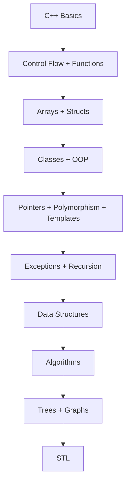

# Preface

## Changes in the Eighth Edition

1. It introduces several C++ features:
    * digit separators (C++14) (Chapter 3)
    * class inline functions (C++11) (Chapter 10)
    * in-class data member initialization during declaration (C++11)
    * random generators (C++11)(Chapter 13).

2. Some C-string functions like `strcpy`, `strcmp`, and ``strcat`` are deprecated and may trigger warnings.
3. ``strncpy`` and ``strncmp`` may not be available in all C++ implementations.
4. The Chapter 13 example ``newString`` was updated to use character-array copy functions instead.


## Approach:

C++ is presented as both a structured and object-oriented language, and the book covers both.

It focuses on ANSI/ISO Standard C++, with some discussion of features not available in earlier Standard C++.

- Chapter 1: Computer hardware/software, how C++ programs are processed, structured vs.  object-oriented programming.
- Chapter 2: C++ fundamentals and basic syntax.
- Chapter 3: Input/output.
- Chapters 4–5: Control flow — selection and loops.
- Chapter 6: Functions, parameter passing, and scope of the identifier. . **Important for beginners.**
- Chapter 7: Enumerations, ``namespaces``, and ``string``.
- Chapter 8 covers arrays and adds range-based ``for`` loops, search, and sort algorithms.
- Chapter 9: ``struct`` / records. Optional chapter.
- Chapters 10–11: begin OOP with classes, abstract data types (ADTs), inline functions, in-class initialization, inheritance, composition, and object-oriented design.
- Chapter 12: Pointers, dynamic memory, pointer-based classes, abstract classes, and virtual functions.
- Chapter 13: Polymorphism, overloading, templates, and random number generation.
- Chapter 14: Exception handling.
- Chapter 15: Recursion. Can be studied independently after **Chapter 9**.
- Chapters 16–17: Data structures — linked lists, stacks, and queues.
- Chapter 18: Searching/sorting algorithms + performance analysis.
- Chapter 19: Binary trees, BSTs, traversals, and AVL trees.
- Chapter 20: Graphs, graph representation, traversal, shortest path, MST, topological sort.
- Chapter 21: STL — containers, iterators, stacks, queues, and algorithms.
- Appendices: C++ reference material, operators, character sets, files, libraries, memory sizes, exercises, etc.

The book emphasizes practical use, algorithm analysis, and when to apply different algorithms.

**Overall progression**



## How to Use the Book

1. OOD is Object-Oriented Design : It is the planning stage.
    * you decide what classes, objects, responsibilities, relationships, and interactions the system should have.

2. OOP is Object-Oriented Programming :  It is the coding stage or programming style.
    * you implement that design using classes, objects, inheritance, encapsulation, polymorphism, and so on.

In short:

- OOD = how to design the solution
- OOP = how to implement the solution in code

Here’s a very small C++ example:

```cpp
#include <iostream>
using namespace std;

// OOP: writing the class
class Car {
public:
    void start() {
        cout << "Car started\n";
    }
};

int main() {
    // Using the class in code
    Car myCar;
    myCar.start();
    return 0;
}
```

What is OOD here?
- Before writing the code, you decide: “I need a `Car` class.”
- You decide that a car should have a `start()` behavior.

What is OOP here?
- You actually write the `Car` class.
- You create an object: `Car myCar;`
- You call `myCar.start();`

So:
- OOD = deciding what to build
- OOP = building it in code

```mermaid
flowchart TD
    C1["1. An Overview of Computers and Programming Languages"]
    C2["2. Basic Elements of C++"]
    C3["3. Input/Output"]
    C4["4. Control Structures I (Selection)"]
    C5["5. Control Structures II (Repetition)"]
    C6["6. User-Defined Functions"]

    C7["7. User-Defined Simple Data Types, Namespaces, and the string Type"]
    C8["8. Arrays and Strings*"]
    C9["9. Records (structs)"]
    C10["10. Classes and Data Abstraction"]

    C11["11. Inheritance and Composition"]
    C12["12. Pointers, Classes, Virtual Functions, Abstract Classes, and Lists"]
    C13["13. Overloading and Templates"]
    C14["14. Exception Handling"]
    C15["15. Recursion"]

    C16["16. Linked Lists"]
    C17["17. Stacks and Queues"]
    C18["18. Searching and Sorting Algorithms"]
    C19["19. Binary Trees"]
    C20["20. Graphs"]
    C21["21. Standard Template Library (STL)"]

    C1 --> C2 --> C3 --> C4 --> C5 --> C6

    C6 --> C7
    C6 --> C8
    C6 --> C9
    C6 --> C10

    C8 -.-> C9
    C8 -.-> C10
    C8 --> C15

    C10 --> C11
    C10 --> C12
    C10 --> C14

    C12 --> C13

    C11 --> C16
    C13 --> C16
    C14 --> C16
    C15 --> C16

    C16 --> C17
    C16 --> C18

    C17 --> C19
    C17 --> C20

    C18 --> C21
    C19 -.-> C21
    C20 --> C21
````

**So think of it like this**

```Text
Chapter 1–8
    │
    │ C++ foundations
    ↓
Chapter 9
    │
    │ structs
    ↓
╔══════════════════════════════════╗
║      OOD / OOP CORE              ║
║                                  ║
║ Chapter 10 → Classes & ADTs      ║
║       ↓                          ║
║ Chapter 11 → Inheritance         ║
║       ↓                          ║
║ Chapter 12 → Polymorphism        ║
║       ↓                          ║
║ Chapter 13 → Overloading/Templates║
╚══════════════════════════════════╝
    ↓
Chapter 14–15
    │
    ↓
Chapter 16–21
Data Structures & Algorithms
```

**Most important**: If your goal is to learn OOP/OOD properly, pay particular attention to Chapters 10, 11, 12, and 13.
* Chapter 10 introduces the foundation; Chapters 11–13 build the more advanced OOP/OOD concepts.

### **OOP / OOD progression in this book**
| Chapter                                                                   | Role                                                                          |
| ------------------------------------------------------------------------- | ----------------------------------------------------------------------------- |
| **9. Records (structs)**                                                  | Small introduction to user-defined data                                       |
| **10. Classes and Data Abstraction**                                      | 🟢 **OOP starts here** — classes, objects, encapsulation, ADTs                |
| **11. Inheritance and Composition**                                       | 🟢 **OOD + OOP** — inheritance, composition, object relationships             |
| **12. Pointers, Classes, Virtual Functions, Abstract Classes, and Lists** | 🟢 OOP — dynamic objects, abstract classes, virtual functions, polymorphism   |
| **13. Overloading and Templates**                                         | 🟢 OOP/generic programming — overloading, templates, polymorphism             |
| **14. Exception Handling**                                                | Supporting C++ technique; not specifically OOP                                |
| **15. Recursion**                                                         | Algorithm/problem-solving, not OOP                                            |
| **16–21**                                                                 | Data structures + algorithms, but implementations use OOP/generic programming |
